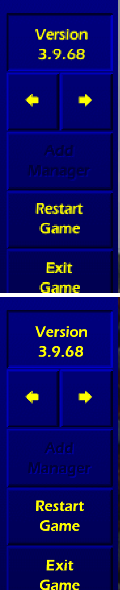
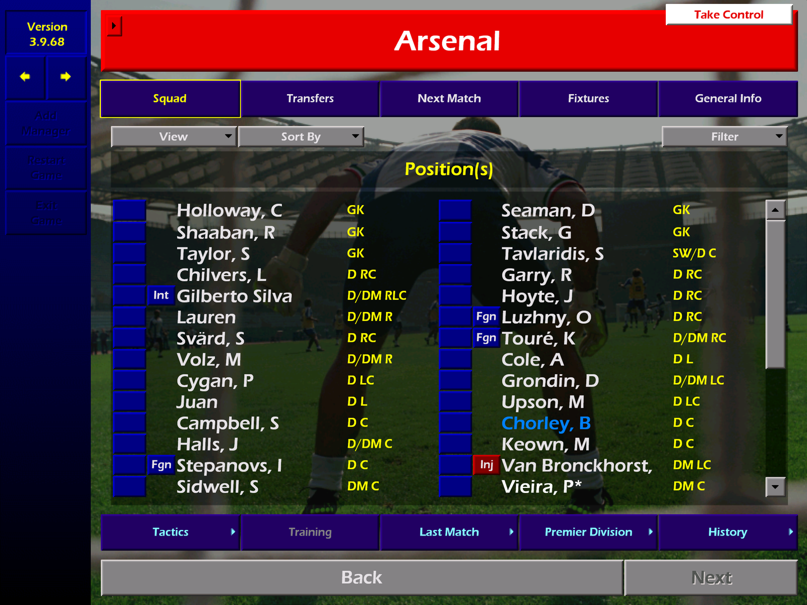

# CM0102 Display Fix

Championship Manager 01/02 on modern screens: sharp scaling up to 4K, crisp text, and fullscreen and windowed modes that work.

The game draws an 800×600 picture. On a 1440p or 4K monitor Windows shows it as a tiny window or a blurry stretch, and the in-game *Windowed* mode often fails outright. This mod fixes that without changing the game's exe on disk.

| Scaled game text (top) | Text redrawn by this mod (bottom) |
|---|---|
|  |  |

## Features

- **Sharp scaling.** [cnc-ddraw](https://github.com/FunkyFr3sh/cnc-ddraw) (OpenGL, OmniScale shader) scales the 800×600 frame to your screen, keeping 4:3 with black bars.
- **Crisp text.** The game's text is drawn again at your screen's resolution with a TrueType font, instead of being scaled up from 800×600. This covers the default *Futuristic* fonts. With *Traditional* fonts the game draws its text as before.
- **Screen Mode works.** Game Settings → Screen Mode: *Full* is borderless fullscreen and *Windowed* is a resizable window. Alt+Enter switches between them, and the maximize button works like in any other window. The first window is sized to fit your monitor.
- **Nothing changes on disk.** The patching happens in memory when the game starts. Each hook is installed only if the game code there is the original 3.9.68 code, otherwise that part turns itself off.

## Requirements

- Championship Manager 01/02 patched to **3.9.68**, started through `cm0102.exe` (`cm0102_GDI.exe` is not supported).
- A graphics card with OpenGL.
- For crisp text: the font **Eras Demi ITC**, which comes with Microsoft Office. Without it the game still runs scaled, just with the normal pixel text.
- Tested on Windows 11 with a 4K monitor (3840×2160 at 200% scaling). Other resolutions and Windows scaling levels should work the same way but have not been tested yet.

## Install

1. Download the zip from [Releases](../../releases).
2. If the game folder already has `ddraw.dll`, `ddraw.ini` or `dsound.dll` (another wrapper such as dgVoodoo), move them somewhere safe.
3. Unpack the zip into the folder that contains `cm0102.exe` and start the game as usual.

To uninstall, delete the files listed in `README-CM0102-Display-Fix.txt`. Settings are in `cmfix.ini` (crisp text on or off, font, size) and in `ddraw.ini` (cnc-ddraw: window size, shader). `cmfix.log` explains what was turned on at startup and why anything turned itself off.

## Compatibility with community patches

The patch sets of [CM0102Patcher](https://github.com/nckstwrt/CM0102Patcher) and [CM0102Loader](https://github.com/nckstwrt/CM0102Loader) were checked byte by byte against this mod's hook points: the Saturn v1–v9 sets, the year-specific sets for 2020–2026 and the misc patches. None of them touches the code this mod hooks. Resolution patches (1280×800, 1024×576, …) change the game's frame size: crisp text then turns itself off and the game draws its own text. A 1280×800 exe was tested this way. Details are in [_docs/compat_patches.md](_docs/compat_patches.md).

## Known limitations

- Some text stays low-res: input fields while you type, text with embedded colours, and the arrow icons.
- Big titles use Eras instead of the game's HandelGothic.
- Behind modal dialogs the menu text underneath is hidden instead of dimmed.
- With resolution patches there is no crisp text (yet).

## How it works

`dsound.dll` (cmfix) is a proxy for the system DirectSound. It forwards `DirectSoundCreate` and patches the running game:

- The graphics init hook (`0x5E2620`) always takes the game's 800×600 path and turns the chosen Screen Mode into cnc-ddraw's borderless or windowed mode.
- **text4k** hooks the game's single text routine `draw_string` (`0x5E5160`). Instead of drawing glyphs, it records each string with its position, font and colour. Hooks on the game's blit primitives (put, grab, present, dim, panel) track which strings are still visible. On cnc-ddraw's render thread, a `SwapBuffers` hook draws the visible strings with GDI-rasterized TrueType text on top of the scaled frame.

The design notes and the reverse-engineering findings are in `_docs` (in Russian). [phase2b_text_spike.md](_docs/phase2b_text_spike.md) covers text4k.

## Building

- **Requirements:** Visual Studio Build Tools (x86 C compiler) and Python 3 with Pillow, mss, pefile, pywin32, capstone and psutil for the test harness.
- **Build `dsound.dll`:** `_tools\cmfix\build.bat`.
- **Build the release zip:** `python _tools\release\release.py`. It writes the zip and its SHA256 list to `_release\`. cnc-ddraw 7.1.0.0 is expected unpacked in `_downloads\cnc-ddraw-v7.1.0.0\extracted`.
- The rest of `_tools` is a test harness (launch, input, capture, scenarios) that drives a separate dev copy of the game; see `_tools\README.md`.

## Credits and license

- This mod: MIT, see [LICENSE](LICENSE).
- [cnc-ddraw](https://github.com/FunkyFr3sh/cnc-ddraw) by FunkyFr3sh: MIT.
- OmniScale shader by Lior Halphon: MIT, notice inside the shader file.
- Championship Manager 01/02 belongs to its owners. No game files are included.
